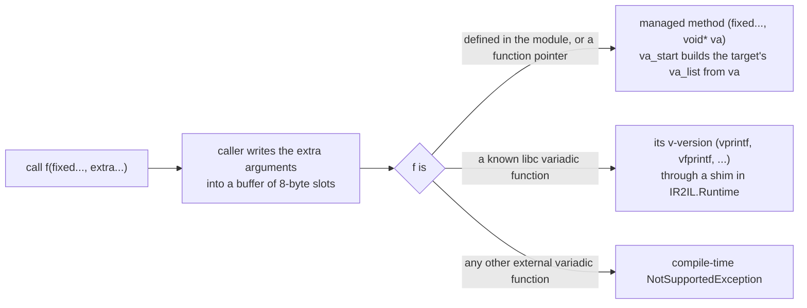

# Varargs and stdio: design

Status: proposed (2026-11-24). Nothing here is implemented yet.

This document replaces IR2IL's three separate mechanisms for variadic calls and C stdio with one convention that works the same on every platform, and moves all formatting and output to the real C runtime.

## Current state

Variadic calls are handled in three different ways:

1. **`printf`, `fprintf` and `__sprintf_chk`** are caught by name in `FunctionILEmitter.EmitCall`, on every platform (the comment there says non-Windows, but the check has no platform condition). They go to `__printf`-style overloads generated by `CompiledModule.GetOrCreate*Overload`. These overloads box the arguments into an `object[]` and call `PrintfHelper.*Core`, which parses the format string in managed code and writes through `Console`. On Windows, the `printf` body that the UCRT headers put into the module is compiled but never called.
2. **Every other variadic function** (defined in the module, external, or called through a function pointer) uses the CLR vararg convention: `CallingConventions.VarArgs` in `ModuleCompiler.CompileMethod`, `ModuleCompiler.CreateExternMethod` and the `calli` in `EmitCall`. `LLVMVaStartIntrinsicFunction` uses `arglist` and assumes CoreCLR's layout (arguments at `8 + 8 * <fixed parameter count>`). This only works on Windows x64, so c-testsuite `00140`, `00186`, `00189`, `00204` and Fujitsu `0011_0178`, `0011_0251` are skipped elsewhere. The `va_arg` instruction is not implemented.
3. **`puts` and `putchar`** are redirected to `PrintfHelper.Puts`/`PutChar`, which write through `Console`.

Problems this causes (most are listed in `TODO.md`):

- Output from managed code (`printf`, `puts`) and from native code (`fputs`, `fwrite`, `perror`, ... via P/Invoke) goes through two separate buffers and can come out in the wrong order.
- `fprintf` to a `FILE*` other than stderr, such as one from `fopen`, writes to stdout.
- `__sprintf_chk` ignores `buflen`. `sprintf`, `snprintf`, `v*printf` and the `scanf` family are missing.
- Every `printf` call allocates an array and boxes each argument.
- The managed formatter has to imitate libc, including platform differences such as the size of `%l`.
- `CompiledModule` has three copies of the same overload generator.
- The `0021_*` and `00210`–`00218` tests (`extern int printf(...)`) are excluded.

## Findings

Measured on macOS ARM64 with .NET 11 (the experiment code was in `/tmp/printf-abi`):

| Approach | Result |
|---|---|
| P/Invoke of `printf` with `CallingConventions.VarArgs`, as the compiler emits today | `InvalidProgramException: Vararg calling convention not supported` |
| Plain non-variadic `DllImport` of `printf(fmt, int, double)` | Garbage: Apple ARM64 passes variadic arguments on the stack, not in registers |
| `vprintf(fmt, ulong* slots)` with a `stackalloc` buffer of 8-byte slots (int, double, `char*`, `long long`, char) | Correct |
| Native `puts` mixed with managed `Console.Write`, stdout piped | The managed line came out before earlier native lines. libc's buffer is flushed when `Main` returns normally |

How clang lowers `va_arg` for each target:

| Target | `va_list` | `va_arg` in the IR |
|---|---|---|
| Darwin ARM64 | `ptr` to 8-byte slots | the `va_arg` instruction |
| Windows x64 | `ptr` (`char*`) to 8-byte slots | written out by clang (load, advance) |
| Linux AArch64 | struct `{ __stack, __gr_top, __vr_top, __gr_offs, __vr_offs }` | written out by clang |
| Linux x86-64 | struct `{ gp_offset, fp_offset, overflow_arg_area, reg_save_area }` | written out by clang |

In every case clang has already lowered aggregate arguments in the IR: a struct larger than a slot is passed as a pointer or split into slot-sized pieces (`[2 x i64]`), and C's default promotions have made every argument at least `i32` or `double`.

A per-call-site P/Invoke stub with a rewritten signature (padding the registers on Apple ARM64) also works for native variadic functions, but it was rejected: it is target-specific trickery, it cannot work reliably on Linux x86-64 (a P/Invoke cannot set `al`), and it still needs the convention below for functions defined in the module.

## Design

### 1. One convention for variadic calls: a hidden buffer pointer

- A variadic LLVM function compiles to an ordinary method (`CallingConventions.Standard`) with a hidden last parameter `void* va`.
- At a variadic call, the caller writes the extra arguments into a buffer and passes its address as `va`:
  - each argument takes one 8-byte slot, or `ceil(size / 8)` slots for larger IR types such as `[2 x i64]` or `i128`;
  - a type with 16-byte alignment (`i128`, `fp128`) starts on a 16-byte boundary when the target requires it (Darwin ARM64, Linux);
  - integers narrower than 64 bits are written sign-extended to 64 bits (respecting the normalisation rule in `CLAUDE.md`), `float` is already `double` after promotion.
- The buffer is one scratch area per function, `localloc`'d once in the prologue with the size of the function's largest variadic call. Never `localloc` per call: a call in a loop would grow the stack. One area per frame is enough, because IR arguments are SSA values, so calls never overlap within a frame, and the callee cannot keep a `va_list` after it returns.
- The same convention applies to `calli` through a function pointer whose type is variadic.

### 2. `va_start`, `va_arg`, `va_copy`, `va_end`

The layout of `va_list` comes from the module's target triple (not from the host OS), in one place:

| Target | `va_start(ap)` |
|---|---|
| Darwin ARM64, Windows x64 | `*ap = va` |
| Linux AArch64 | `__stack = va`, `__gr_offs = 0`, `__vr_offs = 0` (no register arguments left), tops unused |
| Linux x86-64 | `gp_offset = 48`, `fp_offset = 176` (no register arguments left), `overflow_arg_area = va` |

With the registers marked as used up, the `va_arg` code clang writes out on Windows and Linux reads every argument from the buffer unchanged.

- **`va_arg` instruction** (emitted on Darwin ARM64): load the pointer from the `va_list`, align it for 16-byte types, load the value, store the pointer advanced by the argument's slot size.
- **`llvm.va_copy`**: copy the `va_list` (8 bytes, or the struct size on Linux).
- **`llvm.va_end`**: nothing.
- `LLVMVaStartIntrinsicFunction` loses its `arglist` offset hack.

### 3. Known libc variadic functions call their `v`-version

A table in one place maps each known external variadic function to a shim in `IR2IL.Runtime` that takes the fixed arguments and the `va` pointer:

| C function | Shim calls |
|---|---|
| `printf` | `vprintf` |
| `fprintf` | `vfprintf` |
| `sprintf`, `snprintf` | `vsprintf`, `vsnprintf` |
| `__sprintf_chk`, `__snprintf_chk` | `__vsprintf_chk`, `__vsnprintf_chk` |
| `scanf`, `sscanf`, `fscanf` | `vscanf`, `vsscanf`, `vfscanf` |

- The shims hide the OS differences. On Linux the shim builds the `va_list` struct from `va` as `va_start` does. On Windows, UCRT exports none of these functions: the shims call `__stdio_common_vfprintf` / `__stdio_common_vsprintf` / `__stdio_common_vfscanf` with the options the headers use by default (`*__local_stdio_printf_options()`; check the value against the UCRT headers) and `__acrt_iob_func(1)` for stdout. This also covers a bare `extern int printf(...)` declaration on Windows, which should let the `0021_*` and `00210`–`00218` tests run.
- On Windows, a normal `#include <stdio.h>` program needs none of this: the header's own `printf` is compiled into the module as a variadic function, its `va_start` gives `va`, which is already a Windows x64 `va_list`, and it P/Invokes `__stdio_common_vfprintf` itself.
- Any other external variadic function (`open`, `fcntl`, `ioctl`, `execl`, ...) fails at compile time with a `NotSupportedException` naming the function, until it is needed. `open` with a mode could get a shim when a test needs it.
- The interception by name in `EmitCall` goes away: a variadic external is resolved once, when its declaration is compiled (`ModuleCompiler.CreateMethodDeclaration`).

### 4. All stdio goes through libc

- `puts` and `putchar` lose their special cases in `CreateMethodDeclaration` and become ordinary P/Invokes.
- No compiled program writes to `Console` any more. This fixes the ordering bug and `fprintf` to any `FILE*`, and gives exactly the native formatting (`%l`, `%a`, `%g`, locale).

## What this removes

- `PrintfHelper`'s formatter and its `Fileno` workaround (the class itself goes, or keeps only the shims of §3).
- `CompiledModule.GetOrCreatePrintfOverload`, `GetOrCreateFprintfOverload`, `GetOrCreateSprintfChkOverload`.
- The name check for `printf`/`fprintf`/`__sprintf_chk` in `FunctionILEmitter.EmitCall`.
- Every `CallingConventions.VarArgs` in the compiler.
- The `arglist` layout assumption in `LLVMVaStartIntrinsicFunction`.
- The "not supported on non-Windows because they use varargs" exclusions in `CompilerTests.cs`.
- These `TODO.md` items: boxing in `printf`, output ordering, `fprintf` to files, `__sprintf_chk` `buflen` and the missing `sprintf`/`snprintf`/`v*printf`/`scanf`, the `CompiledModule` duplication, and `va_arg`/portable `va_start`.
- The "Handling varargs on macOS ARM64" section of `CLAUDE.md`, to be rewritten to describe this convention.

## Limits and risks

- **Native code calling a variadic function of the module** through a function pointer would use the native convention, not the hidden pointer. This belongs with the existing `TODO.md` item on function pointers mixing managed and unmanaged conventions; it is rare in practice.
- **Buffered stdout.** libc fully buffers stdout when it is a pipe and flushes it at a normal exit. A crash loses buffered output, where today's autoflushed `Console` keeps it. Programs calling `exit()` are fine (it is the libc `exit`).
- **Only macOS ARM64 was tested.** The Linux `va_list` initialisation and the Windows `__stdio_common_*` shims follow the ABI documents and the IR clang produces, and need checking on those platforms.

## Implementation steps

1. **Variadic convention.** Hidden `va` parameter for variadic methods, argument packing at direct calls and `calli`, the per-target `va_start`, the `va_arg` instruction, `va_copy`/`va_end`; remove `CallingConventions.VarArgs` for module functions and function pointers. The printf interception stays for now. Done when `00140`, `00186`, `00189`, `00204`, `0011_0178` and `0011_0251` pass on macOS and their exclusions are removed.
2. **libc for stdio.** The shim table of §3, plain P/Invokes for `puts`/`putchar`, `NotSupportedException` for other variadic externals; delete the managed formatter, the overload generators and the interception. Done when the whole suite passes with no output differences, then update `TODO.md` and `CLAUDE.md`.
